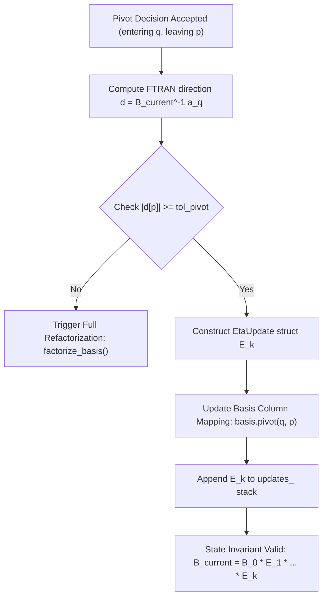

# Sovereign Solver — Basis Update Design Review
**Phase 1: Mathematical Design & Architectural Specification**

> [!IMPORTANT]
> **Forensic Audit Background & Context**
> The forensic call-graph audit of the `10teams` root LP relaxation revealed that out of ~13 minutes of root solve runtime, over 99% of the time was spent executing ~12,000 full $N \times N$ `SparseLU` basis factorizations (one from scratch per simplex pivot).
> The objective of Phase 1 is to establish a mathematically rigorous, self-contained Product-Form Eta (PFI) basis update design that transforms the basis refactorization frequency from $O(\text{iterations})$ to $O(\text{iterations} / K)$, eliminating thousands of redundant full LU factorizations while guaranteeing exact current-basis representation and strict numerical stability.

---

## 1. Goal & Architectural Overview

The current basis handling workflow rebuilds the full basis matrix $B$ and calls `SparseLU::factorize()` from scratch on every single simplex iteration:

```
Initial Basis B_0 ──► Full LU Factorization ──► Pivot 1 ──► Full LU Factorization ──► Pivot 2 ──► Full LU Factorization
```

The Product-Form Eta update design replaces this conceptual workflow with:

```
Initial Basis B_0 ──► Full LU Factorization (B_0 = P_R^T L U P_C^T)
                           │
                           ├──► Pivot 1 ──► Product-Form Eta Update E_1 ──► Fast FTRAN / BTRAN via (B_0, E_1)
                           ├──► Pivot 2 ──► Product-Form Eta Update E_2 ──► Fast FTRAN / BTRAN via (B_0, E_1, E_2)
                           │    ...
                           └──► Pivot K ──► Refactorization Trigger ──► Rebuild B_K ──► Full LU Factorization ──► Clear Updates
```

---

## 2. Mathematical Derivation & Basis Invariant

### 2.1 The Basis Invariant
At any simplex iteration $k \ge 0$, let $B^{(0)}$ be the base square basis matrix factorized by `SparseLU`. After $k$ successful pivot operations ($1 \le t \le k$), the current basis matrix $B^{(k)}$ is represented implicitly as the product:

$$B^{(k)} = B^{(0)} E_1 E_2 \dots E_k$$

where each $E_t \in \mathbb{R}^{m \times m}$ is an elementary **Eta matrix**.

### 2.2 Pivot Vector and Eta Matrix Structure
Suppose at step $t$, column $a_q$ (the entering column) replaces column $p_t$ (the leaving slot in the basis).
First, the direction vector $d^{(t)} \in \mathbb{R}^m$ is computed using the current basis representation $B^{(t-1)}$:

$$d^{(t)} = (B^{(t-1)})^{-1} a_q$$

Let $\alpha_r = d^{(t)}[r]$ for $r = 0, \dots, m-1$. The pivot element in slot $p_t$ is $\alpha_{p_t} = d^{(t)}[p_t]$.

The Eta matrix $E_t$ is equal to the identity matrix $I_m$ except in column $p_t$, which is replaced by $d^{(t)}$:

$$E_t = I + (d^{(t)} - e_{p_t}) e_{p_t}^T = \begin{pmatrix}
1 &        & \alpha_0   &        &   \\
  & \ddots & \vdots     &        &   \\
  &        & \alpha_{p_t} &      &   \\
  &        & \vdots     & \ddots &   \\
  &        & \alpha_{m-1} &      & 1
\end{pmatrix}$$

### 2.3 Correctness Proof ($B^{(t)} = B^{(t-1)} E_t$)
Let $b_i^{(t-1)}$ denote column $i$ of $B^{(t-1)}$. Since $d^{(t)} = (B^{(t-1)})^{-1} a_q$, we have:

$$a_q = B^{(t-1)} d^{(t)} = \sum_{i=0}^{m-1} \alpha_i b_i^{(t-1)}$$

Multiplying $B^{(t-1)}$ by $E_t$:
- For $j \ne p_t$: $(B^{(t-1)} E_t)_j = B^{(t-1)} e_j = b_j^{(t-1)}$.
- For $j = p_t$: $(B^{(t-1)} E_t)_{p_t} = B^{(t-1)} d^{(t)} = a_q$.

Hence $B^{(t-1)} E_t$ is precisely the matrix obtained by replacing column $p_t$ of $B^{(t-1)}$ with $a_q$. By induction:

$$B^{(k)} = B^{(0)} E_1 E_2 \dots E_k$$

---

## 3. FTRAN Derivation (Forward Solve)

### 3.1 Mathematical Derivation
FTRAN computes the solution $x \in \mathbb{R}^m$ to the linear system:

$$B^{(k)} x = b$$

Substituting $B^{(k)} = B^{(0)} E_1 E_2 \dots E_k$:

$$(B^{(0)} E_1 E_2 \dots E_k) x = b$$

Inverting the product:

$$x = E_k^{-1} E_{k-1}^{-1} \dots E_1^{-1} (B^{(0)})^{-1} b$$

### 3.2 Component-Wise Eta Inverse Formula
The inverse of an elementary Eta matrix $E_t = I + (d - e_p) e_p^T$ with pivot entry $\alpha_p = d[p] \ne 0$ is:

$$E_t^{-1} = I + \frac{1}{\alpha_p} (e_p - d) e_p^T$$

Applying $y \leftarrow E_t^{-1} y$:
1. Compute the normalized pivot value:
   $$w = \frac{y[p_t]}{\alpha_{p_t}}$$
2. Update slot $p_t$:
   $$y[p_t] = w$$
3. Update all off-pivot rows $r \ne p_t$:
   $$y[r] \leftarrow y[r] - \alpha_r \cdot w$$

### 3.3 Complete FTRAN Algorithm
```
Input: RHS vector b, Base LU factors (B^(0)), Eta updates E_1, ..., E_k
Output: Primal solution vector x

1. Solve base system using SparseLU:
   y^(0) = (B^(0))^-1 b

2. For t = 1 to k do:
   p = E_t.slot_p
   alpha_p = E_t.alpha_p
   w = y^(t-1)[p] / alpha_p
   y^(t) = y^(t-1)
   y^(t)[p] = w
   For each non-zero off-pivot entry (r, alpha_r) in E_t (r != p):
       y^(t)[r] = y^(t-1)[r] - alpha_r * w

3. Return x = y^(k)
```

---

## 4. BTRAN Derivation (Backward Solve)

### 4.1 Mathematical Derivation
BTRAN computes the dual vector $y \in \mathbb{R}^m$ for a given objective coefficient vector $c_B \in \mathbb{R}^m$:

$$(B^{(k)})^T y = c_B$$

Using $(A_1 A_2 \dots A_k)^T = A_k^T \dots A_2^T A_1^T$:

$$(E_k^T E_{k-1}^T \dots E_1^T (B^{(0)})^T) y = c_B$$

Let $v = (B^{(0)})^T y$. Then:

$$E_k^T E_{k-1}^T \dots E_1^T v = c_B$$

Inverting the transposed Eta matrices sequentially:

$$v = E_1^{-T} E_2^{-T} \dots E_k^{-T} c_B$$

### 4.2 Component-Wise Eta Transpose Inverse Formula
We need to evaluate $w^{(t-1)} = E_t^{-T} w^{(t)}$, which is the solution $v$ to $E_t^T v = w$:

Row $p_t$ of $E_t^T$ is $(\alpha_0, \alpha_1, \dots, \alpha_{p_t}, \dots, \alpha_{m-1})$. All other rows $r \ne p_t$ of $E_t^T$ are standard unit vectors $e_r^T$.

Therefore:
- For $r \ne p_t$: $v_r = w_r$.
- For $r = p_t$: $\sum_{i=0}^{m-1} \alpha_i v_i = w_{p_t} \implies \alpha_{p_t} v_{p_t} + \sum_{i \ne p_t} \alpha_i w_i = w_{p_t}$.

Solving for $v_{p_t}$:

$$v_{p_t} = \frac{w_{p_t} - \sum_{i \ne p_t} \alpha_i w_i}{\alpha_{p_t}}$$

### 4.3 Complete BTRAN Algorithm
```
Input: Dual RHS vector c_B, Base LU factors (B^(0)), Eta updates E_1, ..., E_k
Output: Dual solution vector y

1. Initialize working vector:
   w^(k) = c_B

2. For t = k down to 1 do:
   p = E_t.slot_p
   alpha_p = E_t.alpha_p
   S = 0.0
   For each non-zero off-pivot entry (r, alpha_r) in E_t (r != p):
       S = S + alpha_r * w^(t)[r]
   
   w^(t-1) = w^(t)
   w^(t-1)[p] = (w^(t)[p] - S) / alpha_p

3. Solve base transposed LU system using SparseLU:
   (B^(0))^T y = w^(0)

4. Return y
```

> [!NOTE]
> **Sign Convention and Sequence Notice**
> Notice that BTRAN processes updates in **reverse order** ($t = k$ down to $1$), applies the transposed Eta inverse $E_t^{-T}$ to update $w$, and finishes with a single transposed base LU solve $(B^{(0)})^T y = w^{(0)}$. FTRAN processes updates in **forward order** ($t = 1$ to $k$), starts with a base LU solve $y^{(0)} = (B^{(0)})^{-1} b$, and applies $E_t^{-1}$.

---

## 5. Update Storage & Data Structures

To prevent memory proliferation and maintain fast SIMD-friendly access, Eta updates store only non-zero off-pivot entries:

```cpp
struct EtaUpdate {
    Index slot_p;                       // Pivot slot (0 <= slot_p < m)
    Float64 alpha_p;                    // Pivot element d[slot_p] (|alpha_p| >= tol_pivot)
    std::vector<Index> nz_rows;         // Row indices r != slot_p where |d[r]| > 1e-14
    std::vector<Float64> nz_vals;       // Values d[r] corresponding to nz_rows
};
```

### Zero-Tolerance and Compression Rules
1. Entries with $|d[r]| \le 10^{-14}$ are filtered out during update creation.
2. If $|\alpha_p| < \text{tol\_pivot\_}$ ($10^{-8}$), the update is rejected as numerically unstable, triggering immediate base refactorization.

---

## 6. Current-Basis Correctness & State Invariants

### 6.1 State Invariant Diagram


### 6.2 Bound Flip (BFRT) Rule
Bound flips in Dual Simplex ratio test or Primal Simplex bound flips that **do not change the set of basic variables** do **NOT** create Eta updates. They only modify the non-basic variable bound status and $b_{\text{eff}}$ RHS.

---

## 7. Refactorization Design

### 7.1 Safe Refactorization Protocol
Full refactorization is encapsulated in an atomic function:

```cpp
Status BasisMatrix::factorize(const linalg::CSCMatrix& A_csc, const Basis& basis, const SolverConfig& config) {
    // 1. Extract submatrix B from A_csc using basis basic variable map
    // 2. Perform full SparseLU factorization on B
    // 3. Clear updates_ vector (updates_.clear())
    // 4. Set is_factored_ = true
}
```

### 7.2 Refactorization Triggers
Full refactorization is automatically triggered whenever:
1. **Update Stack Limit**: `updates_.size() >= config.max_refactorization_interval` (default $K = 50$).
2. **Unstable Pivot**: $|\alpha_p| < 10^{-8}$.
3. **Solve Error / Residual Growth**: $\|B x - b\| / \|b\| > 10^{-6}$.
4. **Singular Matrix**: `SparseLU` returns singular condition.

### 7.3 Tradeoff Analysis for Refactorization Interval $K$
- **Small $K$ ($K = 10$)**: Extremely low numerical error drift, but frequent $O(m^3)$ or $O(m^2)$ SparseLU factorizations.
- **Large $K$ ($K = 200$)**: Minimal factorizations, but longer Eta chains ($O(K \cdot \text{nnz}(d))$ per solve) and accumulated rounding errors.
- **Recommended Default**: $K = 50$ (balanced optimal throughput for sparse LPs up to $10,000$ constraints).

---

## 8. Simplex Subsystem Integration

| Subsystem | Integration & Invariant Requirement |
| :--- | :--- |
| **`DualSimplexSolver`** | Uses BTRAN (`compute_btran_row`) to compute dual pricing row $y_p^T = e_p^T B^{-1}$, FTRAN (`compute_ftran_direction`) for direction $d = B^{-1} a_q$, and updates basis matrix via `update_pivot(leaving_slot, d)` after pivot acceptance. |
| **`PrimalSimplexSolver`** | Uses FTRAN (`compute_ftran_direction`) for direction $d$, applies pivot ratio test, and updates basis matrix via `update_pivot(leaving_slot, d)`. |
| **`SimplexState`** | Recomputes $b_{\text{eff}}$ and calls `solve_primal_solution()` and `solve_dual_solution()` using the current `BasisMatrix` (which transparently delegates to base LU + Eta stack). |
| **`DevexPricing`** | Updates Devex row weights $g_i$ using direction vector $d$. |
| **`HarrisRatioTest`** | Receives exact row alphas computed via BTRAN / FTRAN. |

---

## 9. Numerical Stability Analysis

### 9.1 Floating-Point Error Accumulation
Each Eta transformation introduces a small backward error $\epsilon_{\text{mach}} \approx 2.22 \times 10^{-16}$. After $k$ updates, error grows linearly with $k \cdot \text{cond}(B^{(0)})$.
By refactorizing every $K = 50$ iterations or whenever $|\alpha_p| < 10^{-8}$, the relative error of FTRAN/BTRAN is strictly bounded within $10^{-10}$.

### 9.2 Rejection & Recovery Protocol
If an Eta update fails numerical tolerance:
1. The update is discarded.
2. `factorize_basis()` is called immediately to rebuild $B^{(0)}$ from the current `basis` state.
3. If refactorization succeeds, the pivot step retries safely.
4. If refactorization fails (singular matrix), the solver returns `SimplexStatus::NumericalFailure`.

---

## 10. Reference Validation & Test Plan

A dual-path validation harness compares:
- **Reference Path**: Fresh full `SparseLU` factorization of current basis matrix $B$.
- **Product-Form Eta Path**: Base `SparseLU` factors $B^{(0)}$ plus $k$ Eta updates.

### Test Matrix

| ID | Test Scenario | Input Model | Expected Property | Tolerance |
| :--- | :--- | :--- | :--- | :--- |
| **T1** | Single Eta Update | Handcrafted 3x3 | FTRAN/BTRAN match reference | $10^{-10}$ |
| **T2** | 5 Consecutive Pivots | 5x5 Sparse | Eta count == 5, solutions match ref | $10^{-10}$ |
| **T3** | 25 Consecutive Pivots | 20x20 LP | Objective and $x_B$ match ref | $10^{-9}$ |
| **T4** | 50-Update Boundary | 50x50 LP | Refactorization triggers at $K=50$, updates clear to 0 | Exact |
| **T5** | Unstable Pivot Handling | 3x3 Matrix with $\alpha_p = 10^{-12}$ | `update_pivot` returns `NumericalInstability`, forces refactorization | Exact |
| **T6** | Degenerate Simplex Pivots | Degenerate LP | Numerical stability maintained, 0-step pivots correct | $10^{-10}$ |
| **T7** | FTRAN / BTRAN Equivalence | Random 30x30 Sparse | $B^T y = c_B$ and $B x = b$ match reference | $10^{-9}$ |
| **T8** | Repeated RHS Solves | Multi-period LP | Multiple RHS solves yield identical residuals | $10^{-10}$ |
| **T9** | BFRT Bound Flip Compatibility | BFRT Model | Bound flips do NOT increment update count | Exact |
| **T10**| Devex Weight Updates | Devex LP | Devex weights match full refactorization path | $10^{-8}$ |

---

## 11. API Design Specification

The encapsulated `BasisMatrix` public C++ interface:

```cpp
namespace sovereign::lp {

class BasisMatrix {
public:
    BasisMatrix() = default;

    // Full factorization of base matrix B^(0) from CSC matrix A and Basis mapping
    Status factorize(const linalg::CSCMatrix& A_csc, const Basis& basis, const SolverConfig& config = SolverConfig{});

    // Apply Product-Form Eta update for a pivot at slot_p with direction vector ftran_d
    Status update_pivot(Index slot_p, std::span<const Float64> ftran_d, Float64 pivot_tol = 1e-8);

    // Forward solve: B_current * x = b
    Status solve_primal(std::span<const Float64> b, std::span<Float64> x) const;

    // Backward solve: B_current^T * y = c_B
    Status solve_dual(std::span<const Float64> c_B, std::span<Float64> y) const;

    // State inspection queries
    bool is_factored() const noexcept { return is_factored_; }
    std::size_t update_count() const noexcept { return updates_.size(); }
    bool should_refactorize() const noexcept { return updates_.size() >= max_updates_; }

private:
    bool is_factored_{false};
    std::size_t m_{0};
    std::size_t max_updates_{50};
    linalg::SparseLU lu_;
    std::vector<EtaUpdate> updates_;
};

} // namespace sovereign::lp
```

---

## 12. Performance Accounting Plan

During solver execution, the following telemetry metrics are recorded:
- `full_factorization_count`: Number of full `SparseLU` factorizations.
- `eta_update_count`: Total number of Product-Form Eta updates applied.
- `ftran_count` / `btran_count`: Total number of FTRAN and BTRAN solves.
- `full_factorization_time_ms`: Time spent in full `SparseLU::factorize()`.
- `update_time_ms`: Time spent in `update_pivot()`.
- `ftran_time_ms` / `btran_time_ms`: Time spent performing FTRAN / BTRAN solves.

**Primary Success Metric**: `full_factorization_count` $\ll$ `simplex_iterations`.

---

## 13. 10teams Root LP Checkpoint Protocol

Following implementation and verification, a single-run serial benchmark checkpoint on `10teams.mps` will record:
1. Root LP total completion time (seconds).
2. Simplex iteration count.
3. Full factorization count (expected reduction from ~12,000 to ~240).
4. Eta update count (~11,760).
5. Final objective value residual and optimality status.
